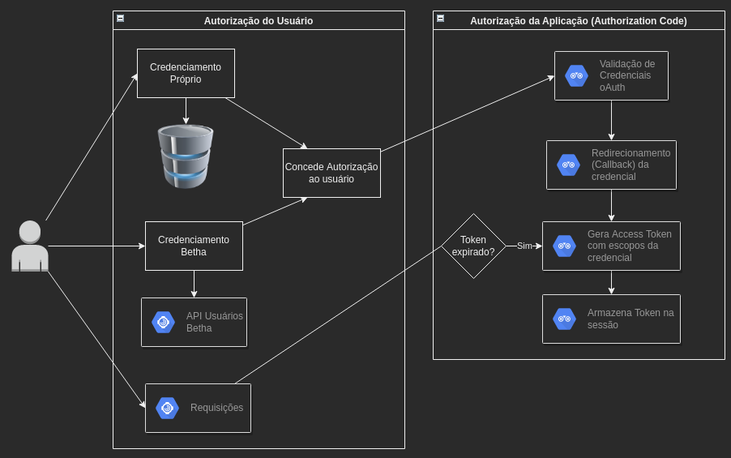
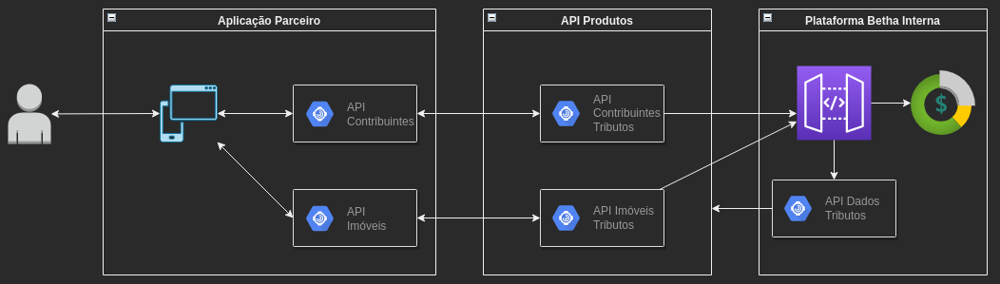
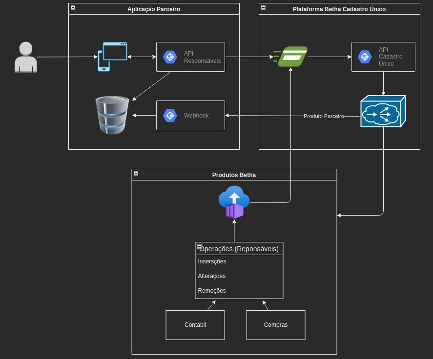

# Plataforma Integração Demonstração
Esse projeto tem como objetivo servir como base para integrações de Produtos de parceiros com a plataforma da Betha Sistemas.

<br><br><br>

# Back-end

## Autenticação

A camada de autenticação/autorização da Plataforma é disponibilizada sobre o protocolo OAuth 2. O OAuth 2 é um protocolo amplamente utilizado, 
principalmente por grandes players de plataforma, provendo acesso aos seus recursos de forma segura para aplicações de terceiros.

## Implementação

**Nessa aplicação de exemplo foi possuí o fluxo conhecido como Authorization code, e as seguintes características podem ser observadas:**
- Durante o login com a Betha, existe um redirecionamento do usuário
- Após login com sucesso, é retornado para uma página da aplicação (callback) junto com um código de autorização
- Esse código de autorização é trocado por um access token
- O access token é armazenado na sessão (mas poderia ser utilizado qualquer outro mecanismo)
- A cada requisição é verificado se o token não expirou, caso tenha sido expirado é iniciado um processo de renovação



O backend funciona como BFF (*Backend for Frontend*): o login OAuth (Authorization Code com PKCE e `state`) é feito pelo
backend e o navegador recebe apenas um cookie de sessão. Access token e refresh token nunca chegam ao frontend.

<br><br><br>
**Integração com o Gerenciador de Autorizações:**
- O usuário seleciona a entidade (contexto) com o `bth-selecao-contexto` e pode trocá-la depois sem novo login. O parâmetro `?exercicio=` é opcional: quando recebido, é preservado na sessão e nos links de produtos; este sistema de exemplo não exige exercício
- O aceite do termo de responsabilidade é exigido antes do primeiro uso do acesso
- Cada endpoint de `/api/v1` é autorizado na Plataforma conforme o [page-mapping](back/page-mapping/page-mapping.json) (consultar, incluir, alterar e excluir independentes); menus, rotas e botões do frontend são apenas feedback visual
- A sessão é verificada a cada minuto e a atividade é registrada (no máximo a cada 2 minutos), o que bloqueia a aplicação em caso de timeout por inatividade, desconexão administrativa, login concorrente ou restrição de horário/IP
- O IP do usuário é enviado à Plataforma no header `x-bth-ip-address`
- Administradores têm acesso ao Gerenciador de Acessos pelos utilitários; acessos técnicos e administradores têm a tela de Suporte técnico
- Os componentes Betha que chamam APIs da Plataforma (`bth-marca-produto`, `bth-notificacoes`) recebem um token fictício e apontam para proxies do backend, que usam o token da sessão. As notificações em tempo real passam por um relay de WebSocket no backend
- Logout encerra a sessão local e a sessão na Betha

**Configuração:** os valores de exemplo estão em [`back/src/main/resources/config/application.yaml`](back/src/main/resources/config/application.yaml).
Antes de executar, informe o ID numérico do sistema e configure a credencial OAuth de servidor no Studio. Substitua
`betha.auth.oauth.client.id` e `betha.auth.oauth.client.secret` localmente ou sobrescreva essas propriedades no ambiente de execução; não publique
credenciais reais. Cadastre `http://localhost:8080/callback` como URI de retorno da credencial para o ambiente local e
ajuste callback, URLs e cookie conforme a implantação.

**Page Mapping:** publique [`back/page-mapping/page-mapping.json`](back/page-mapping/page-mapping.json) com uma credencial
de serviço do mesmo projeto, com a API Autorizações Dados e o escopo `autorizacoes.plataforma.betha.cloud/parceiro.escrita`
habilitados. O token dessa credencial é diferente do token do usuário. Execute a partir da pasta `back`, substituindo
`<TOKEN_DA_CREDENCIAL_DE_SERVICO>` pelo token obtido no Studio:

```sh
curl --fail-with-body --request PUT \
  'https://autorizacoes.suite.betha.cloud/dados/v1/page-mapping/latest' \
  --header 'Content-Type: application/json' \
  --header 'Authorization: Bearer <TOKEN_DA_CREDENCIAL_DE_SERVICO>' \
  --data-binary '@page-mapping/page-mapping.json'
```

Confirme a publicação com `GET https://autorizacoes.suite.betha.cloud/dados/v1/page-mapping/latest`, usando o mesmo
token com permissão de leitura. A validação de permissões do exemplo envia `Page-Mapping-Version: latest`.

**Frontend e backend na mesma origem:** o cookie de sessão e a proteção CSRF dependem disso. Em desenvolvimento, o
`ng serve` encaminha `/api`, `/login` e `/callback` para o backend ([proxy.conf.json](front/proxy.conf.json)). Fora do
ambiente local, sirva os dois sob o mesmo host, com qualquer proxy que roteie esses caminhos para o backend e o restante
para os arquivos do frontend. O IP do usuário só é lido do `X-Forwarded-For` quando o proxy está numa rede privada ou
loopback; se não estiver, informe o IP dele em `server.tomcat.remoteip.internal-proxies`.

<br><br><br>
**Integração com API's do Tributos, para exemplo:**
- Consulta de Imóveis
- Consulta de Contribuintes
- Como header das requisições é utilizado authorization e userAccess, gerados com escopo especifico para o tributos


<br><br><br>
**CRUD de Responsáveis, para exemplo, como algo do domínio local da aplicação:**
- Nela contém exemplos de envio de comando para o cadastro único
- Webhook para receber comandos de Changes do cadastro único



## Executando a aplicação

**Dependencias**
- Java 8 (ou superior)
- Maven 3.5.4 (ou superior)

**Passo a passo**
- Entrar na pasta docker e executar o comando `docker-compose up -d`
- No terminal, executar o comando: ```mvn spring-boot:run```


<br><br><br>

# Front-end


## estrutura-componentes-angular

Exemplo para o [@betha-plataforma/estrutura-componentes](https://github.com/betha-plataforma/estrutura-componentes) com Angular

## Inicializando

Instalar dependências

```
yarn
```

Iniciar servidor de desenvolvimento em http://localhost:4200

```
yarn start
```

A coleção de componentes está sendo definida em [**src/main.ts**](./src/main.ts)

Os estilos estão sendo importadas no [**angular.json**](./angular.json) e sendo configurados em **architect.build.options.styles**

Os componentes estão definidos no [**src/app/app.component.html**](./src/app/app.component.html) e configurados em [**src/app/app.component.ts**](./src/app/app.component.ts)
